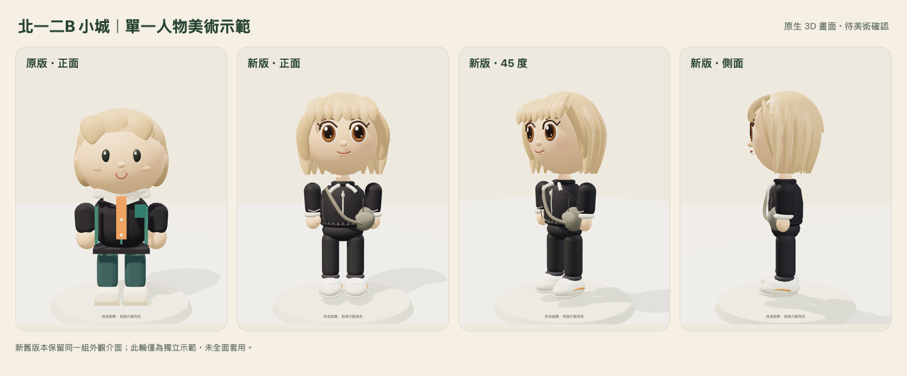

# 單一 Q 版人物美術示範・驗收與技術評估

狀態：**可玩隔離示範，等待美術確認，尚未全面導入。**

試玩：[人物美術預覽](https://counting-molecular-traveling-blocked.trycloudflare.com)。免費臨時入口至台北 **2026-10-31 23:59**，不是永久正式主機。

## 已完成

原人物為 Three.js r170 的程序式幾何、MeshStandardMaterial 與樞紐動畫，沒有外部骨架／高解析貼圖。本輪新增一名約 2.6 頭身的原生人物：曲線臉頰與下巴、較完整的眼睛／眉毛／鼻嘴、眨眼與微笑、立體分層髮束、圓潤衣袖／手腿／鞋底、領口／拉鍊／衣料線與肩包。動作保留呼吸、行走擺動、坐下、揮手與原 greet/highfive/stumble；轉身僅平滑視覺樞紐，權威位置與朝向不變。

頭、髮型、衣物、四肢分組，並維持原 setAppearance/setHairStyle/setColor/animate/dispose 介面。新舊切換不改 profile 或同步封包。街坊、其他玩家與載具騎士仍保留原 factory；本輪不是全角色替換。

## 效能差異

Mac 上 WebKit，390×844、DPR1；展台每版熱身2秒後取7秒樣本。展台畫面在手機尺寸限制約30 FPS。

| 項目 | 原版 | 新版 | 解讀 |
|---|---:|---:|---|
| 展台繪製呼叫（含底座） | 16 | 15 | 沒有以更多 draw calls 換細節 |
| 單人物三角面 | 14108 | 19578 | +38.8%，仍需手機驗證 |
| 單人物幾何緩衝 | 545868 bytes | 674276 bytes | +0.122 MiB；不是程序總記憶體 |
| 展台幀時間 P50 | 33.0 ms | 33.0 ms | 兩者約30 FPS |
| 展台幀時間 P95 | 40.0 ms | 45.0 ms | 新版尖峰較高，不能只看平均 |
| 新增人物貼圖 | 0 | 0 | 使用幾何、頂點色與原燈光 |

公開城市另外在**已登入且 WebSocket 歡迎完成**後，以同一位置與鏡頭每版取9.5秒樣本：原版平均 35.4 ms（約 28.3 FPS），新版 36.4 ms（約 27.5 FPS）。平均差 2.8%，短樣本差異很小，但不足以證明真機沒有降速。場景中仍有動態車輛／路人與快取，因此總 draw／geometry 計數不當作手機記憶體差。

這些是 **Mac 瀏覽器／手機尺寸結果**。Chromium 使用軟體 WebGL；Mac WebKit 也不是 iPhone Safari。沒有 iPhone 的程序 RSS／GPU 總記憶體數值，不宣稱真機驗收。

## 功能與保存檢查

- 真實 Three.js 模型測試5項通過；另有1項轉身平滑／權威朝向不變檢查通過。髮型×服裝預熱後50次循環的資源數穩定，30次新舊切換保留一名 active model，共享資源不被誤釋放。
- Chromium／WebKit 手機尺寸的原城市流程：行走、付費馬尾、reload外觀與位置、新舊切換不改錢包／profile、雙身份WebSocket、可見peer、沙發坐下與離開均通過，無 script error／WebGL context loss。
- 實際預覽頁的新舊、髮型、衣服、分頁、近看與單一iframe切換通過；HTTPS公開路徑與私人檔案404讀回通過。
- 原城市入口 SHA 仍為 7816d64e87b831531ffbfb4e176043e65ebaa589b662ac8741d04816740158f6；原模型檔案未改。原資料庫只做唯讀核對，沒有重建、寫入、搬移或還原。李舒緩獎勵仍為 1 筆、200 金幣；本輪新增獎勵0。

## 待解決與導入條件

1. 仍需本人確認臉型、髮束、比例與整體風格。髮絲精細度、布料摺痕、鞋面與較豐富表情尚未達參考圖全部細節。
2. 實體 iPhone Safari 的連續行走、換裝尖峰、記憶體壓力、背景返回與第二台實機仍待驗收；展台 P95 增加 5.0 ms，需特別看短暫卡頓。
3. 全面替換前才進行各個人肖像、所有服裝／配件／騎士的適配及多人物手機LOD預算；現在只替換示範玩家，不能以本次短測聲稱全城穩定。
4. 全面導入需要使用者確認；不合併正式入口、不啟用金牌扣款或新獎勵。

證據：model-tests.txt、turning-test.txt、integration-browser.json、acceptance-browser.json、public-browser.json、public-readback.json、original-preservation.json。
