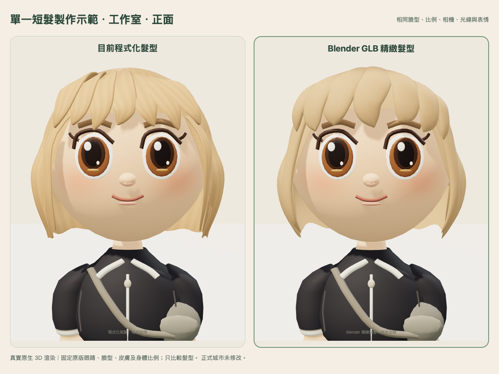
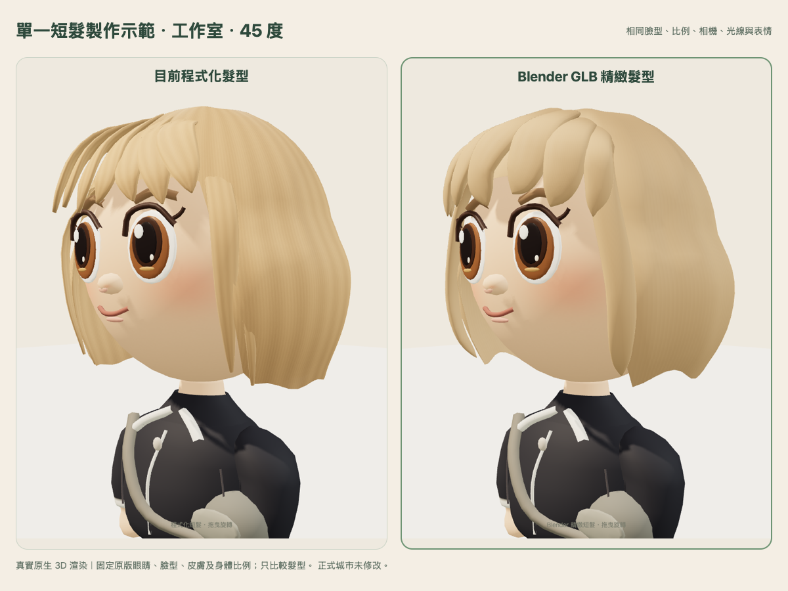
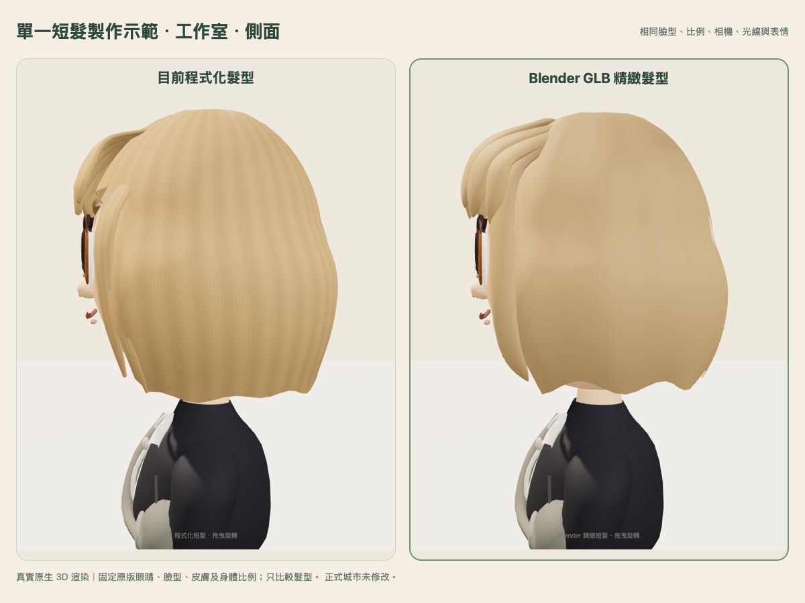
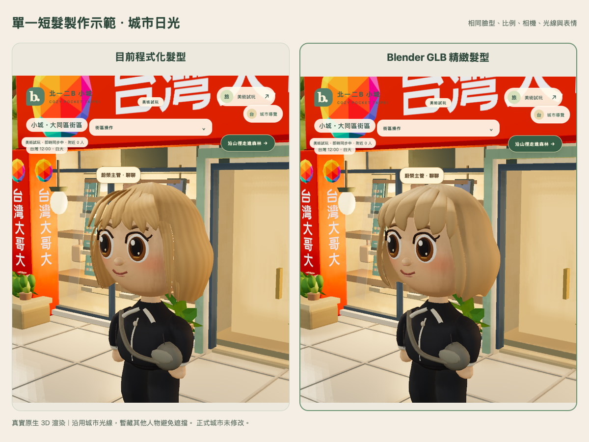
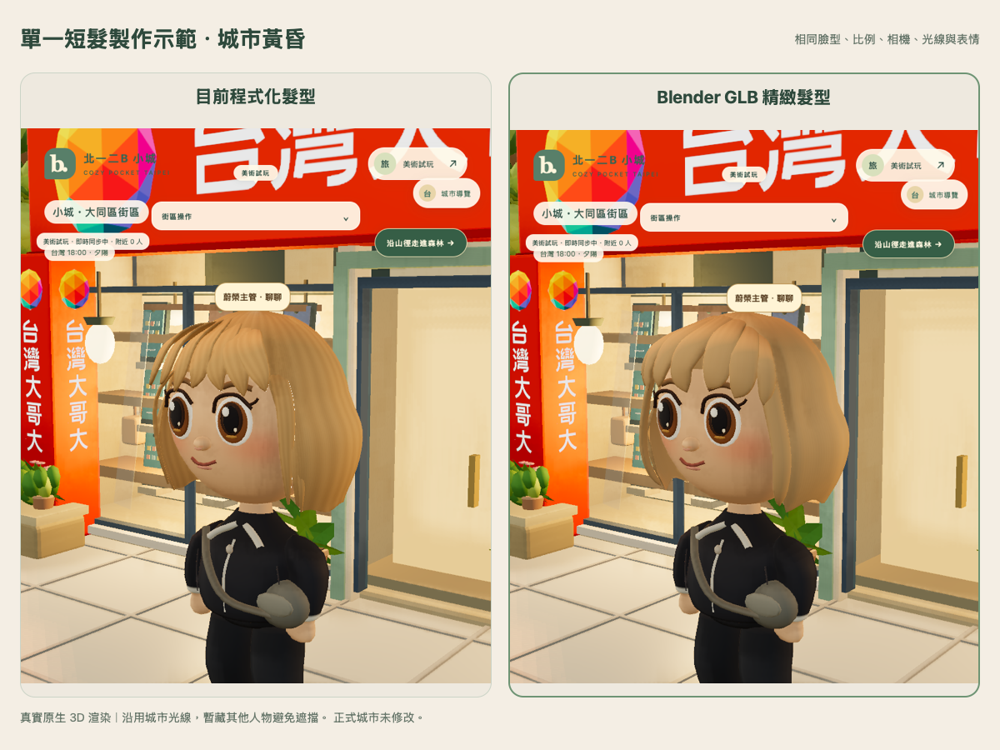
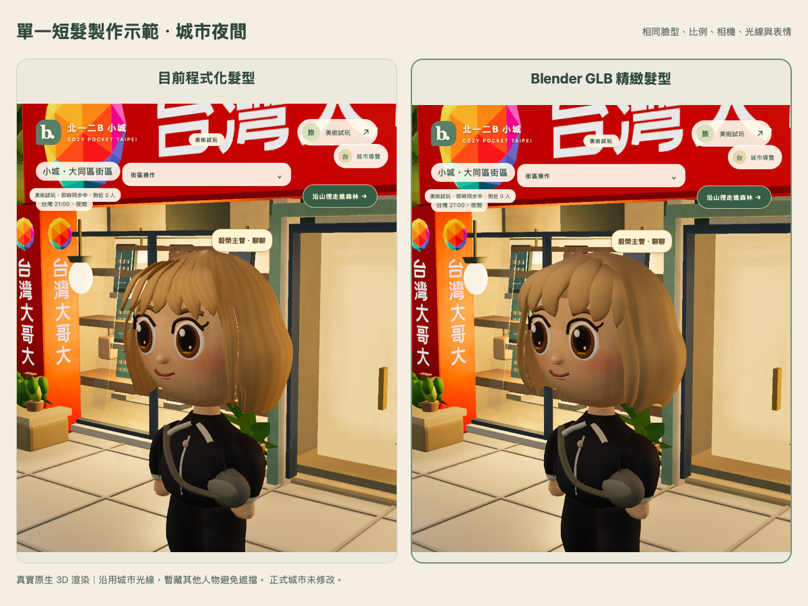

# Blender＋GLB 第一款精緻短髮示範

[開啟可旋轉的真實 3D 預覽](https://ciao-wrap-joel-sydney.trycloudflare.com/)。選擇「目前程式化髮型／Blender 精緻髮型」比較，可拖曳 360°、行走、換裝並切換獨立城市。免費臨時入口依原期限於台北 **2026-10-31 23:59** 關閉。

## 成果與邊界

- 實際使用官方 **Blender 4.5.15 LTS** 建立短髮控制網格、細分、UV 與柔和色彩／法線／粗糙度貼圖，匯出 GLB；保存 [Blender 原始專案](../../assets/hair-glb/short-bob-v1.blend)、[GLB](../../assets/hair-glb/short-bob-v1.glb)、[建模腳本](../../tools/blender-hair/build_hair.py) 與 [匯出收據](../../assets/hair-glb/build-receipt.json)。
- 製作方式是 Blender Python 定義髮型控制點及體積，再使用 Blender 的細分、網格簡化及官方匯出器；不是美術師手工雕刻，也沒有將原 JS 髮型原封不動轉存成 GLB。
- 瀏海由原本較扁的三角髮束改為不等分、帶厚薄與內彎的曲面；側髮根部藏入連續髮量，避免小片狀髮束貼在側面；整理耳旁穿出及側後髮上下段接縫。髮尾改為內收的弧線分束。
- 使用已確認的 `head-integrated.1` 臉型、原版眼睛、五官位置、皮膚、2.5 頭身、身體與肩頸；不改動畫、其他髮型或人物功能。切換只改本頁渲染，不把模型版本寫入 profile 或多人封包。
- 僅獨立示範角色的 bob 使用 GLB；普通同伴／NPC 仍使用原 factory。示範房間能同步角色外觀代號、位置與互動，但沒有把 GLB 批次套用給所有同伴。未修改正式城市或任何既有角色資料，沒有重複發放金幣。

## 相同光線、相同視角

左為本輪開始前確認的程式化髮型，右為 Blender GLB。使用相同 profile、相機、光源與固定表情；圖片均為實際遊戲引擎渲染，沒有修圖或以圖片替換模型。

## 城市實際光線

使用原生城市日／昏／夜光線。截圖只固定該頁呈現時間與暫藏擋鏡頭的人物，沒有修改伺服器時鐘、世界或存檔。

## 模型及效能

| 同一個制服示範角色 | 已確認程式化版 | Blender GLB 版 |
| --- | ---: | ---: |
| 全角色三角面 | 19,332 | 18,792 |
| 幾何屬性陣列 bytes | 562,376 | 605,680 |
| 模型 geometry／material 數 | 13／9 | 13／9 |
| 工作室繪製次數（含底座、地面） | 15 | 15 |
| 全新 context 紋理數（含陰影） | 7 | 7 |
| Mac WebKit 暖機 P50／P95 | 33／35 ms | 33／35 ms |

髮型本身 **6,484 三角面、單一 primitive／單一材質**，GLB **327,908 bytes（約 320 KiB）**。三張貼圖最大 512²，無透明髮片、髮絲物理或新增後製。保留 GLB 的 tangent／UV，沒有經過會丟棄 tangent 的原模型合併流程。

面數略少不等於記憶體更低：GLB 保留 tangent 及 UV 邊界所需的頂點，幾何屬性陣列增加 **43,304 bytes（約 42.3 KiB）**。兩版各自作用中的頭部貼圖，依尺寸與 mipmap 估算皆約 **4 MiB**；不是整個 GPU 或 Safari 程序的實測常駐記憶體。比較頁暖機兩版後會同時保留兩套髮型貼圖，這是比較功能的固定額外成本。

Mac WebKit 使用 390×844、DPR 1、30 fps 節流，兩個全新 context 分開暖機 8 秒後量測 10 秒／四視角。沒有在此條件下看到明顯畫面時間退步；30 fps 上限會掩蓋部分 GPU 差異，因此不能據此宣稱渲染成本相同或實體 iPhone 已順暢驗收。

## 驗證

- 專用 Node 模型與 GLB metadata **7/7** 檢查通過：固定臉部／皮膚／身體與動畫、單一模型及嵌入貼圖、載入失敗回退、資源生命週期。
- Chromium／Mac WebKit：行走、原有路線、保存位置、已購髮型重新載入、雙人 WebSocket 與可見同伴、原沙發坐下／離開通過；切換版本不改伺服器 profile／錢包。
- 兩引擎各 **40 輪**實際 GLB／原版／馬尾與服裝切換：繪圖 geometry **15→15**、texture **10→10**，活動 GLB 實例保持 **1**，舊實例材質持續釋放；沒有 context loss。這是資源計數未見累積，不是長時間手機 RAM 無洩漏證明。
- 實際頭部左右 45° 轉動截圖及 head-parent 檢查通過；髮型跟隨頭部，已檢查預設／行走／測試轉頭的可見視角，未見新增穿出。不將少數測試姿勢擴張為所有極端動作的保證。
- GLB 請求失敗時，兩引擎仍可顯示並操作原本程式化短髮。
- 原整合版入口三項來源 hash 未變、九項凍結來源一致、正式城市 index hash 未變。正式資料庫未開啟，正式 writes／額外金幣發放均 0。

[模型來源與三視圖 raw](native-capture.json)、[玩法回歸](integration-browser.json)、[40 輪資源與轉頭／失敗回退](memory-browser.json)、[分開暖機效能](performance-webkit.json)、[城市光線](city-comparison.json)、[保留檢查](preservation.json)、[公開資產讀回](public-readback.json)、[公開預覽操作](public-browser.json)、[已購服裝續玩](wardrobe-browser.json)、[Node 測試 raw](model-tests.txt)。

## 與最初示意圖仍有的差距

此版先改善體積、銜接及髮尾。瀏海仍是較大的主髮束，側後髮的細碎層次、自然不對稱與流向高光，仍未達示意圖的精細程度；不宣稱已達最終成品。下一輪應依本次實際視覺確認再精修，不增加無助輪廓的面數，也不調整已確認的臉與比例。

實體 iPhone Safari 依使用者安排 **DEFERRED_BY_USER**。長走、背景返回與真機記憶體／穩定性未完成，不能由桌面 WebKit 結果替代。本輪仍是獨立美術示範，未全面導入正式城市。
