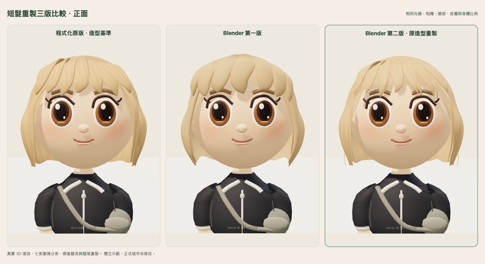
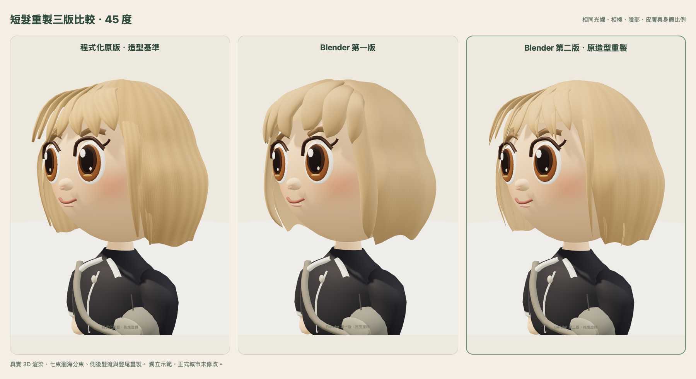
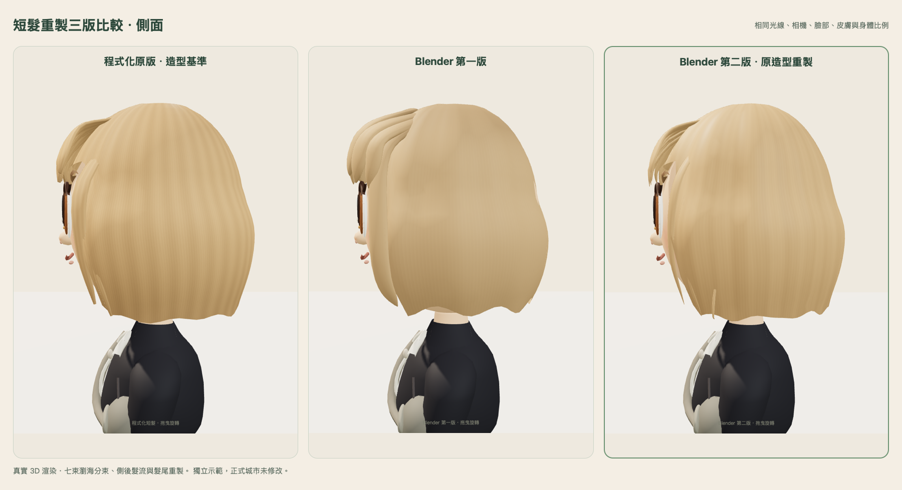
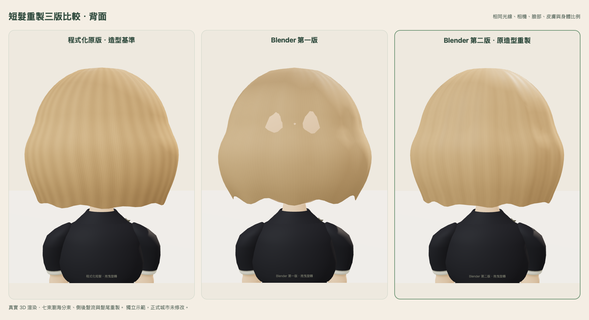
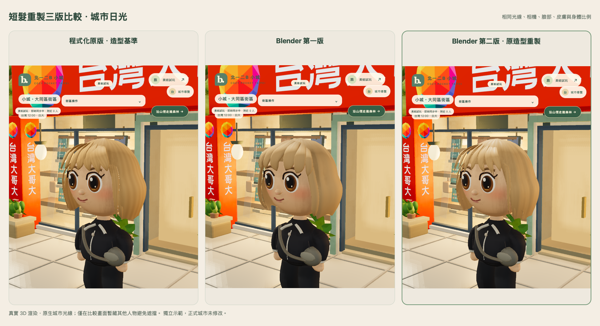
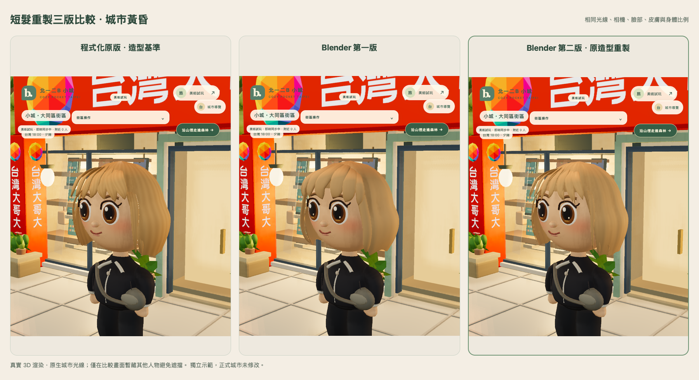
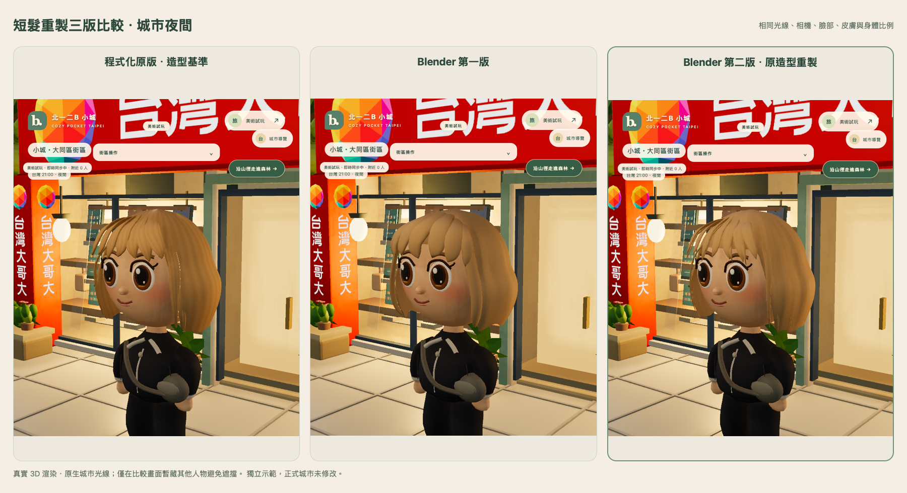

# 短髮重製第二版：三版實際 3D 比較

[開啟可旋轉三版預覽](https://ken-mae-base-always.trycloudflare.com/)。可拖曳 360°，選擇程式化原版／Blender 第一版／Blender 第二版，以及正面、45 度、側面、背面、行走、換裝與獨立城市試玩。免費臨時入口仍於台北 **2026-10-31 23:59** 關閉。

## 本輪以原造型重製

- **瀏海**：保留程式化原版七束主分束的起點、路徑與長短節奏，縮薄截面並提早收尖；在四處加入較細的分束，不沿用第一版粗厚花瓣形狀。
- **側髮**：保留原本兩層臉側髮的長度，調整根部埋入及交疊、細化截面，另有少量細碎髮尾；沒有增加髮絲物理或透明髮片。
- **後腦**：使用連續曲面的方向性髮流與細凹槽。中途檢查淘汰了有浮貼邊緣的大片覆蓋髮層，改讓髮流與主體相接。後腦表面比第一版有更多變化，沒有只用大量獨立面片堆疊。
- **髮尾**：沿原短髮內彎輪廓加入小幅長短變化與收尖，避免整齊厚邊；碎髮數量保持少量。
- **材質**：色彩、法線與粗糙度貼圖沿髮流變化，降低整片均勻的塑膠光感。沿用低成本不透明 PBR 材質，最大貼圖仍為 512²。

眼睛、臉型、五官位置、皮膚、2.5 頭身、身體／肩頸及動畫均保留。第一版 GLB、.blend、建模腳本保持原檔 SHA；第一版 factory/helper 僅另存並改命名空間，避免跟著第二版一起變更。

本輪仍待使用者美術確認，不宣稱技術整合或測試通過就等於已超越原版、或達到最初示意圖。

## 同光線四視角

固定同一 profile、相機、光源與表情。左至右依序為程式化原版、Blender 第一版、Blender 第二版，均為實際遊戲引擎渲染，沒有以圖片代替人物。

背面是本輪新增的比較角度，可見第一版原檔有頭皮穿出；第二版已處理。第一版保持原檔，未為比較圖另外修改。

## 城市實景

使用原生城市日／昏／夜光線。比較截圖只固定該頁呈現時間、暫藏其他人物避免遮擋，沒有更改伺服器時鐘、正式城市或角色資料。

## 實際負擔與效能

| 同一制服角色 | 全角色三角面 | 幾何屬性陣列 bytes | 工作室繪製次數 | 全新 context 紋理數（含陰影） | Mac WebKit P50／P95 |
| --- | ---: | ---: | ---: | ---: | ---: |
| 程式化原版 | 19,332 | 562,376 | 15 | 7 | 33／35 ms |
| Blender 第一版 | 18,792 | 605,680 | 15 | 7 | 33／34 ms |
| Blender 第二版 | 22,628 | 729,448 | 15 | 7 | 33／35 ms |

第二版髮型本身 **10,320 三角面、單 primitive／單一材質**，GLB **479,324 bytes（約 468 KiB）**。相較第一版確有增加幾何，主要用於較細瀏海、側後髮流、髮尾與平滑輪廓；沒有用面數作為美術完成標準。

單獨作用中的頭部貼圖依尺寸與 mipmap 估算約 **4 MiB**，三版相同。比較頁暖機三版後，會固定保留原版髮圖及兩組 GLB 快取，所以紋理數 7→13 是比較功能成本；不能把「切換後數量穩定」說成完全沒有額外記憶體。此數值不含 Safari 程序、全城或 GPU 常駐記憶體。

Mac WebKit 使用 390×844、DPR 1、原有 30 fps 節流；每版全新 context 暖機 8 秒，四視角量測 10 秒。三版在此條件下畫面時間接近；上限可能掩蓋 GPU 餘裕差異，不據此保證實體 iPhone 或全城 GPU 穩定。

## 檢查與保留

- **6/6 focused 模型測試**：兩份基準釘定原 commit；已確認的臉部／皮膚／身體／動畫精確保留、三版切換 profile 不變、GLB 結構、fallback 與資源釋放通過。
- 實際第二版 GLB 對凍結頭部作背半部 **310 條射線採樣**，未見髮面內縮穿出，最小外覆餘量約 0.0070 遊戲單位。另檢查四視角及左右轉頭截圖；這是採樣檢查，並非所有極端姿勢的保證。
- Chromium／Mac WebKit：行走、保存位置、已購髮型重新載入、三版切換保留 profile／錢包、雙人 WebSocket 與可見同伴、原沙發坐下／離開通過。已購海藍服裝在 reload 與切換後保留。
- 兩引擎各 **40 輪**三版／換裝切換：geometry **16→16**、texture **13→13**，活動 V2 GLB 保持 1、V1 保持 0，舊實例材質持續釋放；快取清理後 texture **13→7**、活動實例歸零。GLB 載入失敗仍可操作程式化短髮，未見 context loss。這不等於長時間手機 RAM 無洩漏的證明。
- 公開預覽已逐一檢查三個 native model version、城市同步、返回工作室與單一 iframe。77 項公開資產 HTTP／SHA 讀回一致，六個私有路徑皆 404。
- 舊第一版預覽四項 hash 保持相同、十項固定來源檢查通過。正式城市 index 保持這輪開始前的核身修正版 SHA；本輪不修改登入、權限、角色、金幣、原資料庫或正式城市。**正式 writes 0、獎勵發放 0**。

實體 iPhone Safari 依使用者先前安排延後，**尚未驗收**。

[模型 raw](model-tests.txt) · [四視角 metadata](native-capture.json) · [310條頭部覆蓋檢查](head-clearance.json) · [玩法回歸](integration-browser.json) · [切換／轉頭／清理](memory-browser.json) · [暖機量測](performance-webkit.json) · [服裝續玩](wardrobe-browser.json) · [公開預覽](public-browser.json) · [資產讀回](public-readback.json) · [保留檢查](preservation.json)

## 模型來源與仍有的品質差距

[第二版 GLB](../../assets/hair-glb-v2/short-bob-v2.glb)、[可編輯 Blender 專案](../../assets/hair-glb-v2/short-bob-v2.blend)、[建模腳本](../../tools/blender-hair/build_hair_v2.py)、[Blender 匯出收據](../../assets/hair-glb-v2/build-receipt.json) 均已保存。實際使用既有 Blender 4.5.15 LTS，以 Python 定義控制網格、細分與連續髮流，再由 Blender 匯出；不是手工雕刻，也未安裝新技能或工具。

相較最初精緻日系示意圖，細碎髮絲的非對稱變化、耳側複雜交疊與自然方向性反光仍較簡化。第二版先讓造型回到原版，再改善分束與表面；是否已超越原版，留待本次同條件比較確認，不直接套用正式角色。
