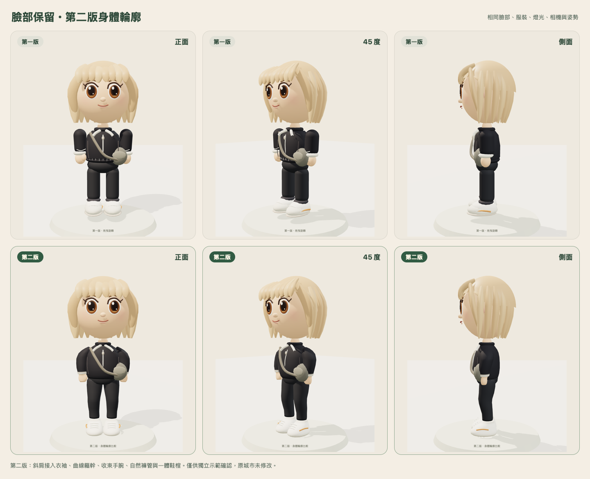

# 第二版身體輪廓示範

狀態：單一原生3D示範，待使用者確認；沒有修改正式城市或全面套用。

[第二版試玩](https://gage-estimates-county-restaurant.trycloudflare.com)。介面「第一版／第二版」皆使用已認可的相同臉部；可在正面、45度與側面切換。期限仍為台北2026-10-31 23:59。

## 本輪修改

- 肩部從頸側向外下斜，再接入曲線衣袖，移除第一版膠囊袖管的平頂。
- 衣袖隨上臂、手肘到手腕漸收；手掌與拇指輪廓整體塑形，袖口保留衣料厚度。
- 軀幹使用連續曲面與胸腰、腹部、下襬曲線；調整胯部露出與褲管接合。
- 大腿、膝部、小腿漸收，鞋子改以連續鞋楦塑出鞋跟、腳背與鞋頭；鞋底貼近地面。
- 約2.5–3頭身。沒有新增服裝、配件或遊戲功能。原服裝只重新配合身體表面。

## 臉部與原版保存

第一版原始模型完整保留，SHA-256：f4434d435e4c8c7c71846759a8e4a824f42b44195f74697d9a0fbc1576694a9a。buildHead、buildHair、animate原始碼完全一致；真實Three.js驗證相同profile下頭部位置、normal／color／index buffers、材質與頭部樞紐一致。四肢樞紐隨新比例調整，動作演算法與互動介面保持。

正式城市入口SHA未改，第一版公開HTML／模型讀回一致。本輪未開啟正式資料庫、未發獎勵、未修改存檔或登入。

## 驗證

- 5項模型檢查通過：凍結V1、臉髮／動畫保留、身體差異與比例、原動作／gesture、20次換裝與切換資源穩定。
- Chromium與WebKit手機尺寸：行走、付費髮型／reload、位置保存、版本切換不改profile／錢包、雙身份WebSocket、可見同伴、沙發互動通過。
- 公開HTTPS預覽的原生模型、已登入WebSocket、近看鏡頭、新舊切換與單iframe返回通過；66檔HTTP／SHA讀回、6個私人路徑404。

## 模型負擔（同一profile、相同展台）

| 項目 | 第一版 | 第二版 |
|---|---:|---:|
| 單人物三角面 | 19578 | 16170 |
| 單人物幾何buffer | 674276 bytes | 531860 bytes |
| 展台draw calls，含底座 | 15 | 16 |
| 人物貼圖新增 | 0 | 0 |

幾何buffer減少21.1%，draw calls增加1次。截圖短樣本不作手機速度結論。公開城市Mac WebKit同鏡頭短測平均第一版35.28ms、第二版34.44ms；存在動態街景與快取差異，不作穩定加速或真機承諾。實體iPhone Safari本輪仍未驗收。

## 待確認

請以正面肩線、45度的腋下／軀幹接合，以及側面的膝部／鞋形為重點確認。這是程序式身體塑形示範，仍可依使用者對圓潤程度與比例的意見調整；確認前不全面導入。
