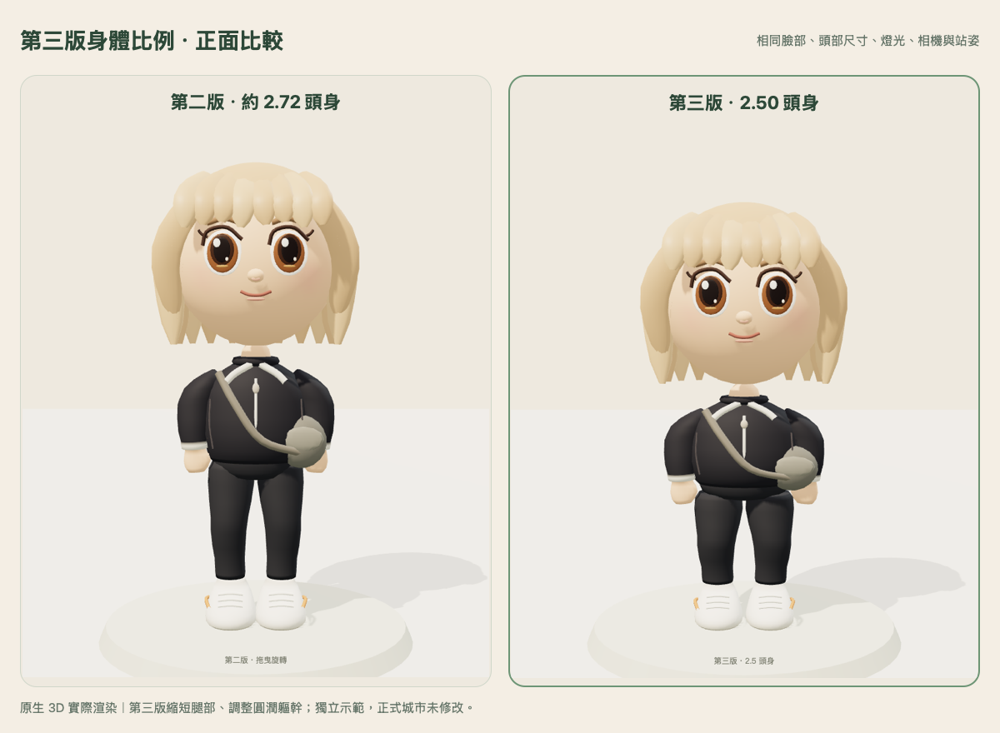
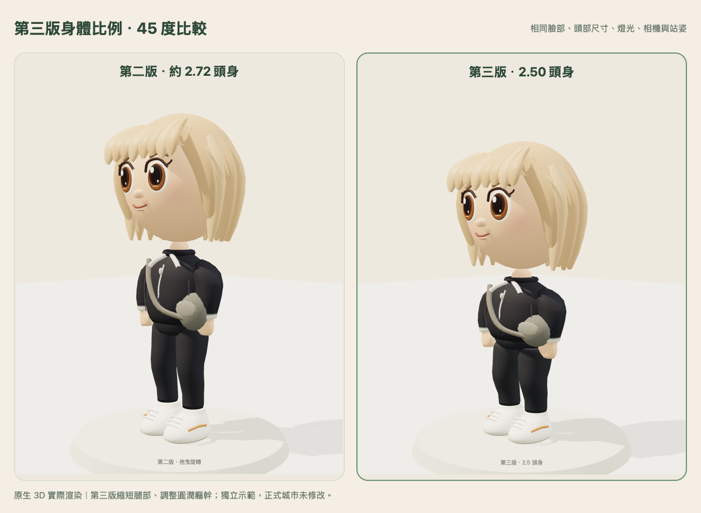
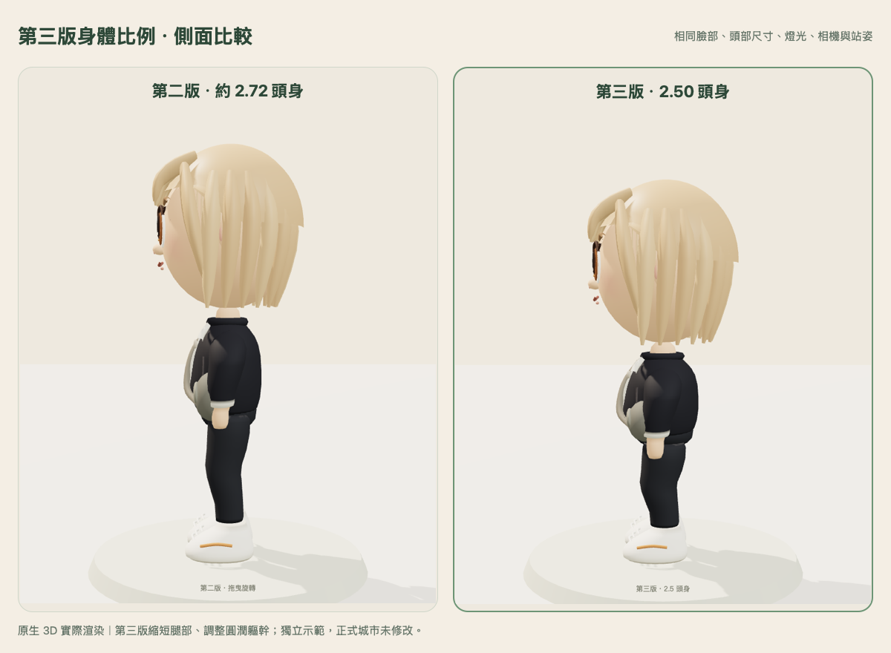

# 第三版 2.5 頭身示範

獨立示範已完成，等待本人確認；正式城市與前兩版預覽未切換。

預覽：https://newspaper-casino-adopted-seems.trycloudflare.com/

台北 2026-10-31 23:59 自動關閉，沿用免費臨時預覽期限。

## 身體比例

量測以不含髮尖的頭頂至下巴為一個頭部單位，直立姿勢的全身包圍盒計算如下。第二、三版頭部都維持 0.9212 單位，沒有放大頭部或把整個人物等比縮小。

| 項目 | 第二版 | 第三版 |
| --- | ---: | ---: |
| 頭身比 | 2.724 | 2.500 |
| 全身高度 | 2.509 | 2.303 |
| 頭部高度 | 0.9212 | 0.9212 |
| 足底高度 | 0.010 | 0.010 |

第三版將腿部高度縮短約 20%，軀幹高度縮短約 15.5%、寬度增加 4%、厚度增加 6%；手臂配合身形縮短，保留圓潤衣袖與手掌輪廓，鞋子縮小 6% 並維持落地。頭部只下移到新的頸部高度，臉型、五官、髮型生成程式與動畫程式完全保留。沒有新增服裝或玩法。

## 同條件原生 3D 比較

所有圖片來自實際模型，使用相同臉部、服裝、燈光、相機與固定站姿。左第二版、右第三版；未用示意圖代替遊戲模型。

城市近看實景：[第三版](game-close-new.png)、[第二版](game-close-old.png)。預覽內可切換版本、正面／45 度／側面與動作。

## 驗證與負擔

- 5/5 原生 Three.js 測試通過：凍結第二版位元組、頭髮／臉部／動畫一致、比例、有限座標、資源釋放與 20 次換裝後資源數穩定。
- Chromium 與 WebKit 的獨立合成角色均通過：行走、購買既有髮型後重新載入、保存位置、版本切換不改錢包／外觀、WebSocket 雙人同步、沙發坐下及離開。兩引擎無頁面錯誤、缺漏資產或 WebGL context loss。
- 公開預覽瀏覽器檢查通過：即時同步連線、城市近看、兩版切換、返回工作室與單一 iframe；66 項公開資產 HTTP／SHA-256 讀回一致，6 條私有路徑皆 404。
- 同一示範造型：兩版均 16,170 三角面、531,860 bytes 幾何陣列、14 份模型 geometry、10 份模型 material；工作室均 16 次 draw calls、1 張 texture。本輪比例修改未增加上述負擔。
- 公開 Mac WebKit 短時間城市樣本：第三版平均 34.61 ms／frame，第二版 35.18 ms／frame。場景包含動態物件且為先後測量，僅記錄，不能據此宣稱效能提升或 iPhone 流暢度驗收。

證據：[模型測試](model-tests.txt)、[原生比較](native-capture.json)、[雙引擎功能](integration-browser.json)、[公開瀏覽器](public-browser.json)、[公開資產](public-readback.json)、[保留檢查](preservation.json)。

## 邊界與待確認

正式城市 index SHA 保持 `7816d64e87b831531ffbfb4e176043e65ebaa589b662ac8741d04816740158f6`；原第二版公開 index 與模型 SHA 仍一致。本輪沒有打開正式資料庫、沒有正式資料寫入、沒有再發 200 金幣。測試使用獨立 SQLite 與合成角色，保留原操作／同步資料契約。

實體 iPhone Safari 的流暢度、記憶體、長走與背景返回尚未驗收；全城既有渲染負擔也未在本輪處理。第三版只供身體比例確認，尚未套用所有角色或正式城市。
