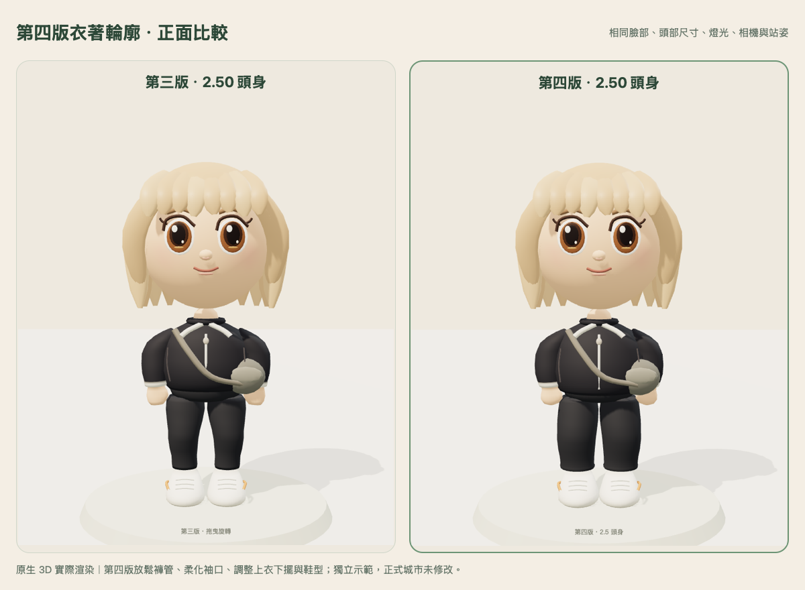
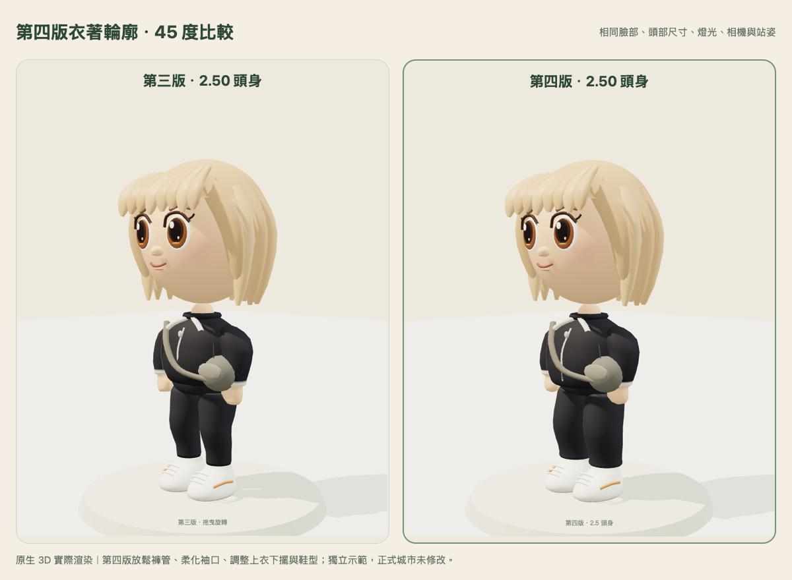
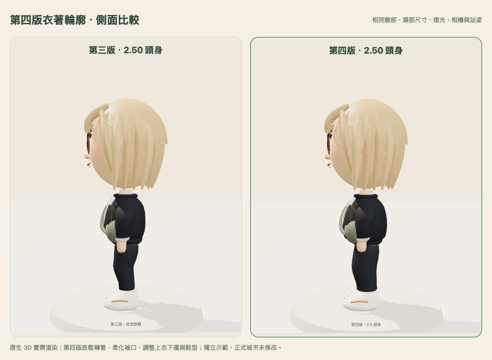

# 第四版獨立示範：身體與衣著自然度

[開啟預覽](https://greensboro-blocks-anniversary-bouquet.trycloudflare.com/)。免費臨時入口依原期限於台北 **2026-10-31 23:59** 自動關閉。

第三版是已認可的 2.5 頭身比例基準；第四版等待本人確認，未套用正式城市或所有角色。

## 本輪改動

- 褲管：保留腿長與腳的位置，放鬆膝部、小腿及褲腳，增加柔和褲腳厚度，降低緊身褲感。
- 手臂：保留動作樞紐，衣袖逐漸收束到薄袖口；手腕、掌心與圓潤指端連續成形，沒有另加圓柱接頭。
- 上衣：增加腰腹衣料餘量，曲線下擺加入前側輕微垂墜及內收厚度；既有拉鍊、背帶與包包重新定位到新衣面。
- 鞋子：維持鞋底高度與腳的位置，鞋頭略寬、略圓，鞋面與鞋帶配合調整。
- 臉型、眼睛、髮型、頭部尺寸、整體身高、腿長與原動畫均保留。沒有新增服裝或玩法。

## 固定比例

以不含髮尖的皮膚頭頂至下巴為一頭部單位，固定直立姿勢：

| 項目 | 第三版 | 第四版 |
| --- | ---: | ---: |
| 頭身比 | 2.500 | 2.500 |
| 頭部高度 | 0.921200 | 0.921200 |
| 全身高度 | 2.303000 | 2.303000 |
| 單腿包圍盒高度 | 0.715000 | 0.715000 |
| 足底高度 | 0.010000 | 0.010000 |

頭部／手臂／腿部樞紐及外層比例轉換與第三版相同。頭部、髮型、動畫 builder 原始碼完全一致；第三版凍結檔與 commit `755861de3ad91da9e47ff1a630b0e57004bba556` 位元組一致。

## 原生 3D 比較

相同服裝、臉部、站姿、相機與燈光，**左第三版、右第四版**。

城市近看：[第四版](game-close-new.png)、[第三版](game-close-old.png)。既有海藍服裝：[換裝續玩實景](wardrobe-ocean.png)。

## 功能與負擔

- 原生 Three.js 模型測試 **5/5 通過**：臉髮／動畫保留、相同比例／腿長／高度、身體幾何確有改變、有限座標、原互動動作、版本切換與一般 peer 保留原模型、20 次換裝循環資源數穩定。
- Chromium 與 Mac WebKit，390×844 手機尺寸：實際行走、位置保存、購買既有髮型後重新載入、版本切換不改錢包／外觀、WebSocket 雙人同步及可見性、沙發坐下／離開均通過；無頁面錯誤、缺漏資產或 WebGL context loss。
- 補充 Mac WebKit：使用原 API 購買及保存既有海藍服裝，確認實際渲染、切換第三／四版及重新載入後保留。錢包與 profile 未因切換／reload 改變。只使用隔離世界合成角色。
- 公開預覽通過工作室、城市即時連線、近看、兩版切換、返回工作室及單一 iframe；66 項公開資產 HTTP／SHA-256 相同，6 條私有路徑均 404。

| 同一示範造型 | 第三版 | 第四版 |
| --- | ---: | ---: |
| 模型三角面 | 16,170 | 16,578（+2.52%） |
| 幾何陣列 bytes | 531,860 | 543,284（+2.15%） |
| 模型 geometry／material | 14／10 | 14／10 |
| 工作室 draw calls／texture | 16／1 | 16／1 |

增加的是褲腳、下擺與手掌的少量輪廓環；沒有新增貼圖或每幀建模。公開 Mac WebKit 短時間城市平均樣本：第四版 34.81 ms／frame、第三版 34.07 ms／frame。動態場景先後測量僅供紀錄，不能宣稱手機效能相同或 iPhone 驗收通過；軟體渲染 Chromium 亦不作為手機速度依據。

## 證據與保留範圍

[模型測試](model-tests.txt)、[原生比較](native-capture.json)、[雙引擎功能](integration-browser.json)、[服裝續玩](wardrobe-browser.json)、[公開瀏覽器](public-browser.json)、[公開資產](public-readback.json)、[保留檢查](preservation.json)。初次兩個測試的摘要層級／材質預熱判定不足已修正，失敗原始紀錄保留於 [initial log](model-tests-initial.txt)；未修改模型來放寬檢查。

正式城市 index SHA 仍是 `7816d64e87b831531ffbfb4e176043e65ebaa589b662ac8741d04816740158f6`；原第三版公開入口與模型 SHA 亦讀回一致。沒有打開正式資料庫、沒有正式資料寫入、沒有重發李舒緩的 200 金幣。第三版／正式城市與原存檔保持原狀。

實體 iPhone Safari 的流暢度、長走、記憶體與背景返回仍未驗收。第四版僅供獨立美術確認。
