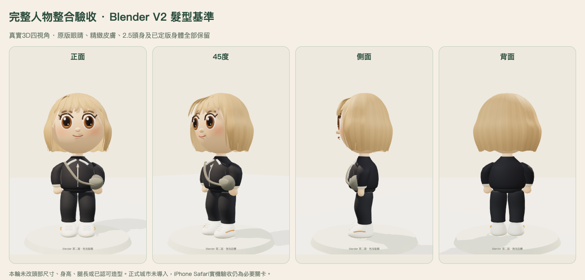

# 完整人物整合驗收：Blender V2 基準

[可旋轉真實3D預覽](https://possibility-recognised-light-webcams.trycloudflare.com/) · [四視角／城市光線比較與導入準備](https://possibility-recognised-light-webcams.trycloudflare.com/review.html) · [詳細導入計畫](ROLLOUT_PLAN.md)

本輪完成隔離桌面整合與導入準備，沒有修改正式城市、既有角色或原存檔。免費獨立入口仍於台北2026-10-31 23:59關閉。**完整人物美術確認與實體iPhone Safari仍是正式導入前的必要關卡；尚未全面導入。**

## 保留與局部檢查

使用者認可的db15e88 Blender V2 GLB、.blend、建模腳本及貼圖保持原SHA。原版眼睛、五官位置、精緻皮膚、臉型、2.5頭身、頭部尺寸、身高、腿長、身體、肩頸、服裝及動畫來源亦保持原檔。沒有為這輪驗收增加模型面數或改造型。

逐一檢查瀏海／側髮接縫、側後髮流與髮尾；310條頭部覆蓋射線採樣最小外覆餘量0.007039，未見採樣部位頭皮穿出。另以實際head pivot左右±45度驗證GLB跟隨，而非把轉相機當轉頭。本輪未發現需重做已認可髮型的結構缺陷；保留V2，沒有另稱一個新髮型版本。產品未新增獨立head-look操作。

## 頭到腳的美術判斷

- 圓潤肩袖、曲面軀幹、寬鬆褲管與圓鞋維持已定版方向，整體輪廓已符合目前Q版基準；這次修正的是取景，沒有調頭身或腿長。
- 全身看得出衣服與肢體銜接比早期積木角色自然，但衣料褶皺、縫線、袖口與鞋面細節仍比最初精緻示意圖簡化。
- 後腦髮流、髮尾收尖及分束可見；非對稱細碎髮絲與方向性高光仍屬較簡化的遊戲表現。
- 日光／黃昏／夜間實際城市渲染，未見缺貼圖、透明排序閃片、明顯破色或context loss。暖色燈光下膚髮色變暖是原生照明結果，不把它改成工作室固定顏色。

因此本輪可供完整人物美術確認，**不把桌面功能通過等同於已達到參考圖全部精緻度**。

## 可審閱的比較

同一profile、制服、臉部及相機；左為程式化短髮基準，右為Blender V2。原身體與皮膚相同，不能將這些圖描述成身體重製前後。

- [正面](comparison-front.png) · [45度](comparison-quarter.png) · [側面](comparison-side.png) · [背面](comparison-back.png)
- [城市日光](comparison-city-day.png) · [黃昏](comparison-city-dusk.png) · [夜間](comparison-city-night.png)
- [髮型近看原圖](detail-quarter.png)

工作室全身已用8個包圍盒角點確認頭頂到鞋底都在畫面內，版間相機數值一致。城市使用同一原生相機與光線；只在截圖暫藏其他人物與教學浮層避免遮擋。城市比較另使用專用新測試世界，防止其他QA玩家加入造成重疊。光線預覽是獨立呈現變數，不改server clock、stationNow、角色profile或錢包。

## 功能、多人與資源

| 項目 | 本輪證據 |
|---|---|
| 行走／權威位置／reload | Chromium、WebKit目前來源通過，先比對browser profile.id與API session UID |
| 換裝 | 原有購買／ownership／profile路徑；已購髮型服裝reload與版本切換保留 |
| 轉頭結構 | 實際head pivot±45度、GLB的父層與world quaternion檢查；沒有新增操作 |
| 家具 | 原沙發路線、坐姿腿部動畫、離開並回到街區通過 |
| 多人 | B實際看到指定QA角色A的V2 GLB；A換成pony／ocean後B更新，再換bob回到GLB；未指定同伴與NPC仍原factory |
| 功能開關／回復 | setEnabled(false)回完整originalFactory，重開恢復同一profile的V2；不新增profile或封包欄位 |
| 40輪切換 | Chromium／WebKit各40輪，每5輪包含legacy回復；geometry18／texture13平台，無context loss，清理後texture7、GLB活動實例0 |

原行走測試曾因fixture寫死舊cookie名稱，瀏覽器另建了測試guest，造成API讀錯UID而失敗。保留失敗說明，修成由Set-Cookie解析名稱並加身份斷言後重跑通過；沒有為通過測試修改game／presence／store。

制服模型22,628三角面、幾何屬性陣列729,448 bytes；含工作室地面與底座的渲染量22,822。Mac WebKit 390×844、DPR1、30fps節流的V2畫面P50/P95為33/35ms。節流可能掩蓋GPU餘裕，繪圖資源計數不是Safari程序／GPU常駐記憶體；本輪未量實體手機RAM。三版比較暖機的texture13包含固定快取，並非沒有額外成本。

## 正式導入狀態

本候選只在獨立世界預演指定actor開關與回復。正式城市未植入開關，也未替換資產或存檔。詳細計畫列出不可變資產、單角色allowlist、照片專屬avatarPreset排除、既有存檔副本／舊client回讀、失敗fallback、釋放快取及不回復資料庫的渲染回復。

下一個必要關卡是完整人物美術確認與實體iPhone Safari（包含貼牆長走、日昏夜、反覆換裝、兩裝置及背景返回）。通過後仍須另做正式城市小範圍patch與發布確認；本輪不直接導入。

[模型](model-tests.txt) · [基準保留](preservation.json) · [全身取景](full-native-capture.json) · [城市光線](city-lighting.json) · [行走／存檔／家具](integration-browser-current.json) · [同伴V2與開關](multiplayer-flag-qa.json) · [40輪資源](memory-current.json) · [暖機效能](performance-webkit.json) · [公開介面](public-ui.json) · [公開資產](public-readback.json)
