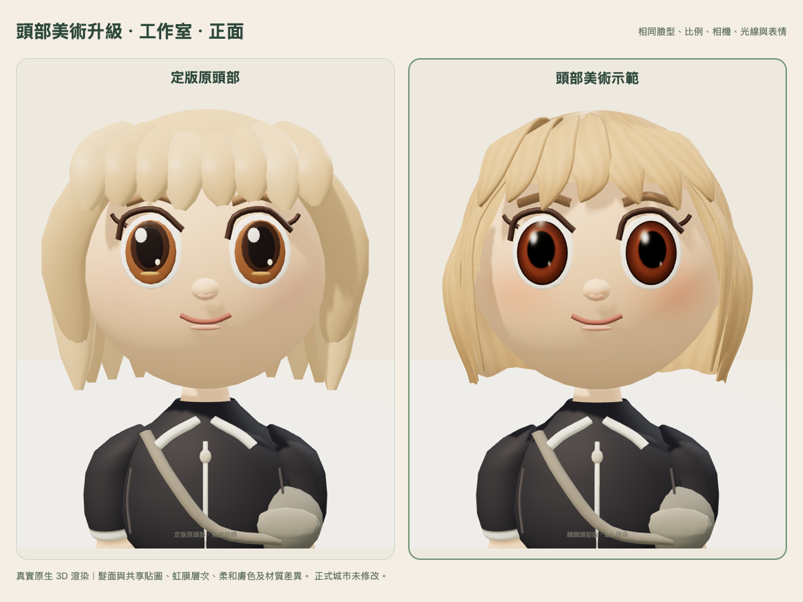
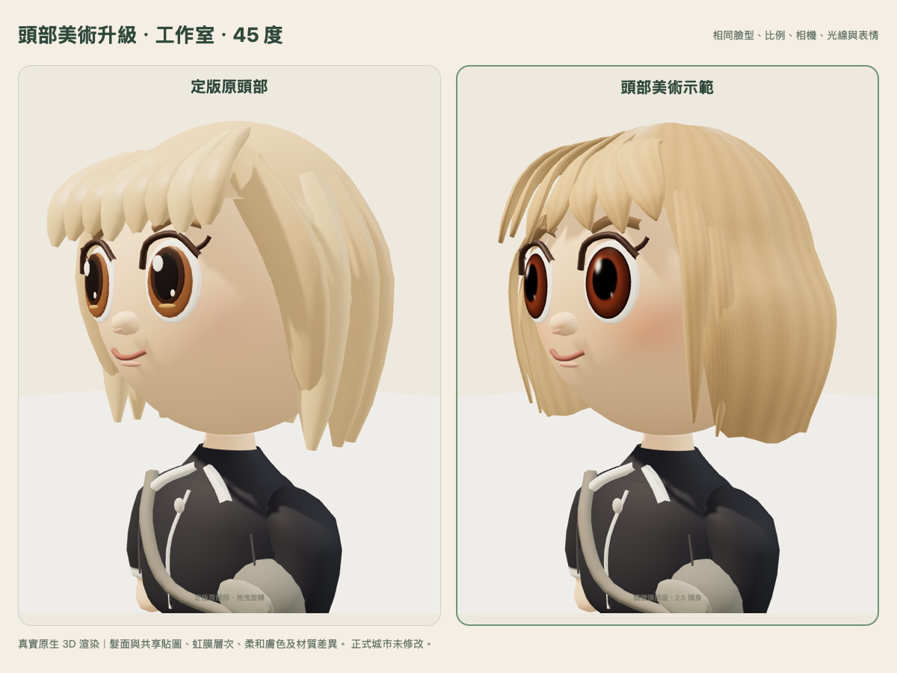
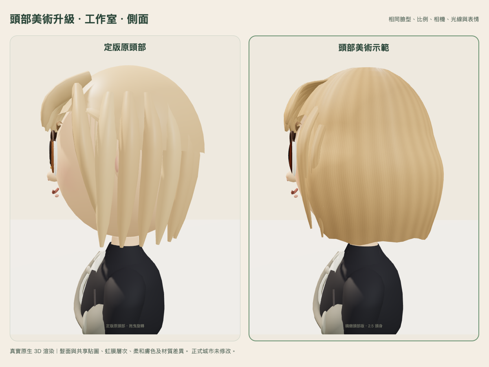
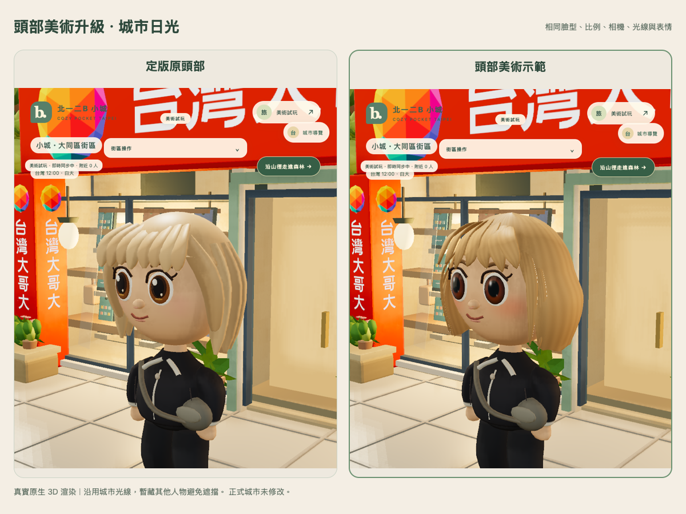
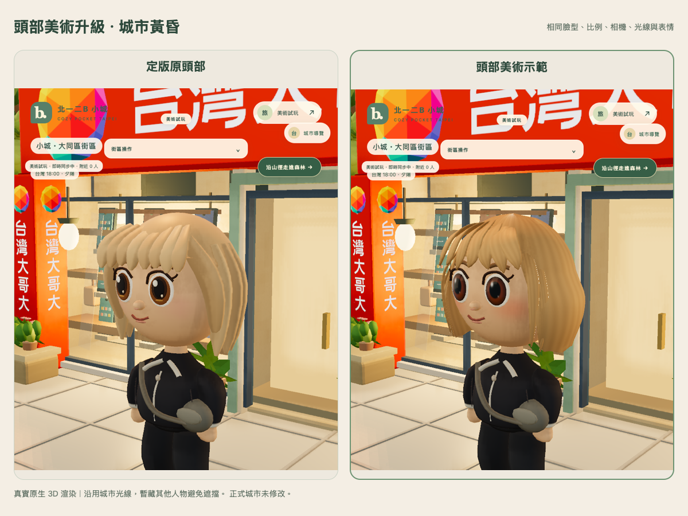
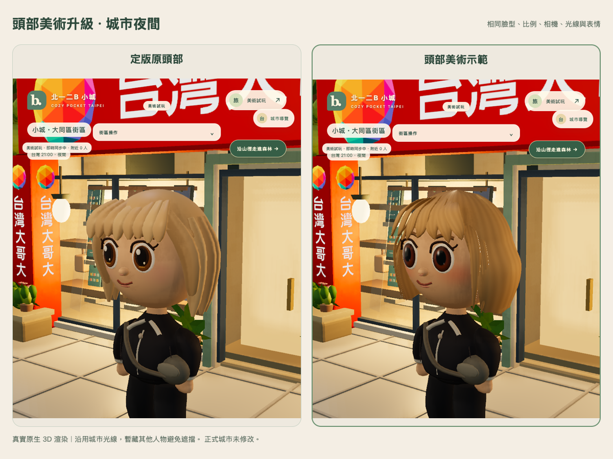

# 頭部美術示範 v1

[開啟可旋轉真實 3D 預覽](https://bookmark-gear-screw-litigation.trycloudflare.com/)。拖曳可環繞 360°，可切換「定版原頭部／精緻頭部版」並進入獨立城市近看。免費臨時入口仍於台北 **2026-10-31 23:59** 關閉。

本輪是第一個頭部材質與髮面示範，尚未視為最初美學參考圖已達標。2.5 頭身、臉型、五官位置、頭部位置、肩頸、身高、腿長及身體造型保持定版；不套用正式城市、不覆蓋角色資料。使用者已將實體 iPhone 驗證延後至回去後進行。

## 製作方式評估與選擇

| 方式 | 判斷 |
| --- | --- |
| 只增加舊幾何的細分數 | 能減少輪廓稜角，不能單獨解決髮絲、虹膜與塑膠感，不作為本輪主要方法。 |
| 重新設計 UV 曲面與共享材質貼圖 | 本輪採用。髮型改成一體髮面與少量封閉髮束；細髮絲、膚色及虹膜層次由貼圖呈現，保留既有模型接口。 |
| 藝術家雕刻／整理拓樸、UV、法線烘焙，再匯出 glTF | 更適合進一步逼近參考圖的精雕髮型與細部接合。現有環境未提供 Blender／Maya，本輪不安裝新工具；先交付可實際評估的原生 3D 研究，再決定是否投入專門資產製作。 |
| 大量透明髮絲層、電影式皮膚散射與後製 | 尚未採用；本輪優先控制手機的材質與像素負擔，沒有新增景深或其他後製。 |

Three.js 官方指出進階 Physical 材質的每像素成本較高，因此本輪限制在一名選定示範角色，其他玩家／NPC 沿用原 factory，並做分開 context 的暖機對照。[材質文件](https://threejs.org/docs/pages/MeshPhysicalMaterial.html)

實際採用：

- **頭髮**：重新設計瀏海、臉側髮束與連續後髮面，加入曲線髮尾、自然分束、柔和高光及共享髮絲色彩／法線／粗糙度圖。不是將原髮條單純複製加量。
- **眼睛**：眼白的尺寸與位置保留；虹膜改成曲面 UV 網格與細緻色彩貼圖，包含瞳孔、虹膜纖維、外緣和柔和高光，搭配局部亮膜材質。
- **皮膚**：臉部頂點位置保留，加入柔和膚色、自然腮紅、細微表面與粗糙度差異，減弱塑膠式反光。
- **材質差異**：頭髮、眼睛、皮膚分開處理。色彩貼圖標示 sRGB，法線與粗糙度保持非色彩資料；遵循 [Three.js 色彩管理](https://threejs.org/manual/pages/color-management.html)。

共享 7 張貼圖：512² 皮膚色彩與髮色，256² 皮膚法線／粗糙度、頭髮法線／粗糙度及虹膜。PNG 來源保存在 `assets/head-art/`，可由 `export-head-atlas.cjs` 重現；實際執行階段只建立一次相同像素的共享 DataTexture，沒有外部美術服務或每幀產生貼圖。

## 同光線、同視角的近距離比較

同一 profile、相機、燈光、站姿與表情，**左定版原頭部、右頭部美術示範**。全部來自實際原生 3D 渲染。

原版來源凍結於 commit `58fd45eca772ca44f01a21b71583df388067f92f`。模型測試嚴格比對臉部頂點集合、眉鼻嘴位置、眼白尺寸、頭部 pivot、身體／腿部／動畫來源；新髮型整體外框亦落在原頭部 envelope ±0.002 模型單位內。

| 中立姿勢 | 原版 | 示範版 |
| --- | ---: | ---: |
| 頭身比 | 2.500 | 2.500 |
| 皮膚頭部高度 | 0.921200 | 0.921200 |
| 全身高度 | 2.303000 | 2.303000 |
| 腿長／身體比例 | 定版 | 保留 |

## 原城市光線下的效果

沿用城市的日照、環境光、燈光與夜間補光程式。比較頁只鎖定呈現用時間，沒有更改伺服器時鐘或資料；其他人物僅在截圖測試中暫藏，避免遮擋。背景是實際城市網格，不是換上的照片。

取樣為台灣 12:00、18:00、21:00；實際 `nightFactor` 分別為 0、0.38、1。公開預覽正常城市仍使用原即時時間與其他人物。

## 效能、功能與驗證範圍

| 同一示範造型 | 原版 | 示範版 |
| --- | ---: | ---: |
| 全角色三角面 | 16,754 | 18,004（+7.46%） |
| 幾何陣列 bytes | 548,036 | 496,032（-9.49%） |
| 模型 geometry／渲染 material 數 | 14／10 | 17／10 |
| 工作室 draw calls | 16 | 19 |
| 新增共享貼圖原始 RGBA | 0 | 3,407,872 bytes（3.25 MiB） |
| 加計 mipmap 的貼圖預算估算 | 0 | 約 4.33 MiB |

貼圖估算不是整個 Safari 程序或實際 GPU resident memory 的量測；未包括驅動、著色器及其他城市資產。Geometry bytes 是頂點／索引陣列，不是整體記憶體。

Mac WebKit，390×844、DPR 1、行動版 30 fps 節流，分開全新 context、暖機 8 秒、取樣 10 秒且包含轉視角：原版／示範版的 p50 均約 **33 ms**，p95 均約 **35 ms**。新 context 的 renderer texture 計數由 1 增至 8，包含共同陰影貼圖。這表示此桌面條件下維持既定節奏，不能推論兩者 GPU 成本完全相同，更不能替代 iPhone Safari 驗收。

- 模型契約 **6/6 通過**：比例／外框、臉與五官保留、身體／腿部／動畫來源不變、有效 UV 與貼圖未被 compile 扁平化、7 張共享圖、20 次換裝／版本切換資源數穩定，dispose 不誤釋放其他模型共享貼圖。
- Chromium／Mac WebKit：行走、保存位置、既有髮型購買後續玩、版本切換不改 profile／錢包、WebSocket 雙人同步及可見性、沙發坐下／離開通過；沒有頁面錯誤、缺漏資產或 context loss。
- 公開預覽與 Mac WebKit：工作室、城市即時同步、頭部近看、兩版切換、返回工作室及單一 iframe 通過。補充確認已購海藍服裝在切換與 reload 後保留。
- 67 項公開資產 HTTP／SHA-256 讀回一致，6 條私有路徑 404。

實體 iPhone：**DEFERRED_BY_USER／未驗收**。還需量測真機首次編譯／上傳尖峰、持續旋轉與城市長走、背景返回、記憶體與熱度；本輪沒有宣稱 Safari 白畫面或全城 GPU 穩定性已解決。

## 與最初示意圖仍有的差距

1. **髮型**已有連續髮面與細髮絲，但側髮交疊、分線、細碎髮尾和根部銜接仍比參考圖簡化；尚不是藝術家精雕模型加高模烘焙的品質。其他髮型保留切換功能，本輪美術比較以金髮 bob 為主。
2. **皮膚**有膚色與粗糙度層次，尚未做真正的次表面散射；耳朵、臉頰的柔和透光感與參考圖仍有差距。
3. **眼睛**以曲面虹膜、亮膜與少量繪製高光近似表現，沒有完整角膜折射／光線追蹤。原本眨眼與表情接口保留，未重製完整眼瞼拓樸。
4. **整體觀感**仍受既定臉部拓樸、眉唇細節與即時渲染限制；參考圖的細膩離線燈光、景深與精雕表面未在本輪複製。身體與服裝按要求保留定版，沒有藉此擴大修改。

接下來應先確認這個頭部方向，再決定是否製作專門的 UV／雕刻／烘焙資產。不能把本輪工程測試通過等同美學參考圖已達標。

## 證據與隔離

[模型測試](model-tests.txt)、[原生比較／來源 SHA](native-capture.json)、[城市光線狀態](city-comparison.json)、[暖機效能](performance-webkit.json)、[貼圖預算](texture-budget.json)、[雙引擎功能](integration-browser.json)、[服裝續玩](wardrobe-browser.json)、[公開預覽](public-browser.json)、[公開資產](public-readback.json)、[保留檢查](preservation.json)。

原定版預覽與模型 SHA 維持一致；正式城市 index SHA 仍是 `7816d64e87b831531ffbfb4e176043e65ebaa589b662ac8741d04816740158f6`。本輪未開啟正式資料庫、正式寫入／額外獎勵發放 0。只有此獨立示範的 Art Lab 近看鏡頭改成頭部構圖；正常遊戲操作、正式入口與原角色資料未修改。
