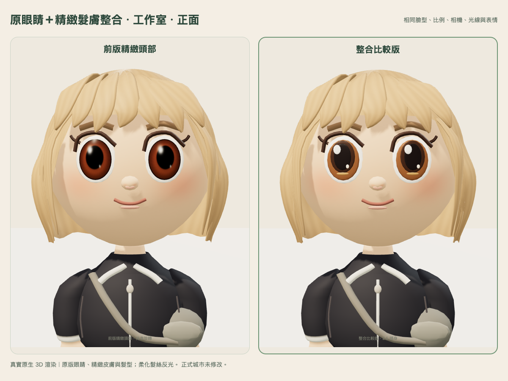
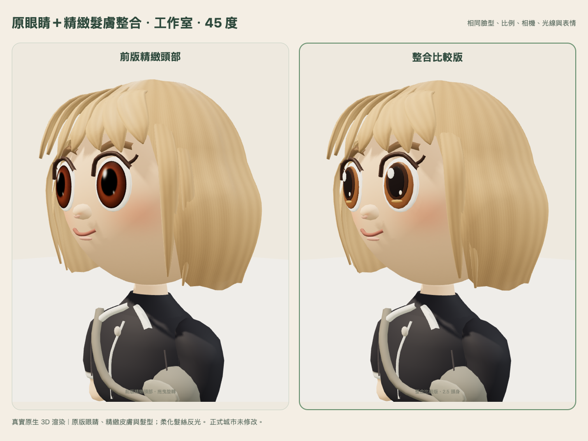
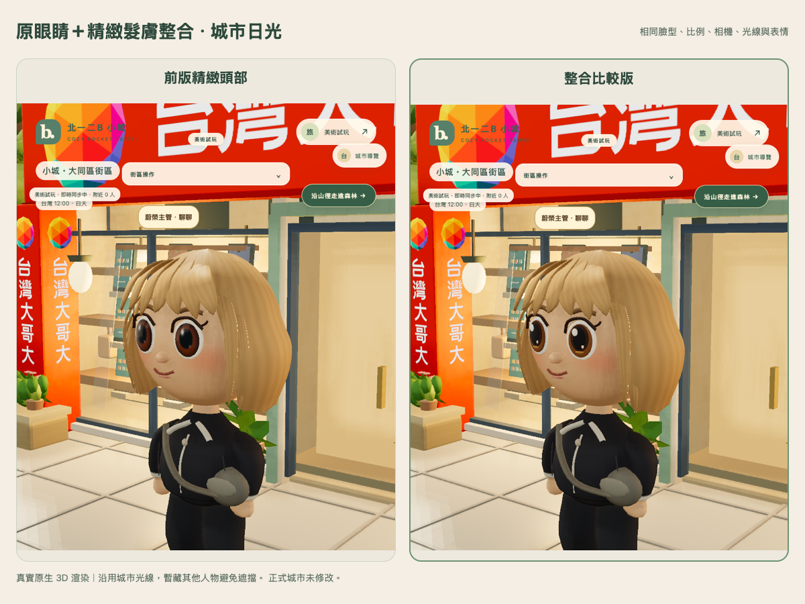
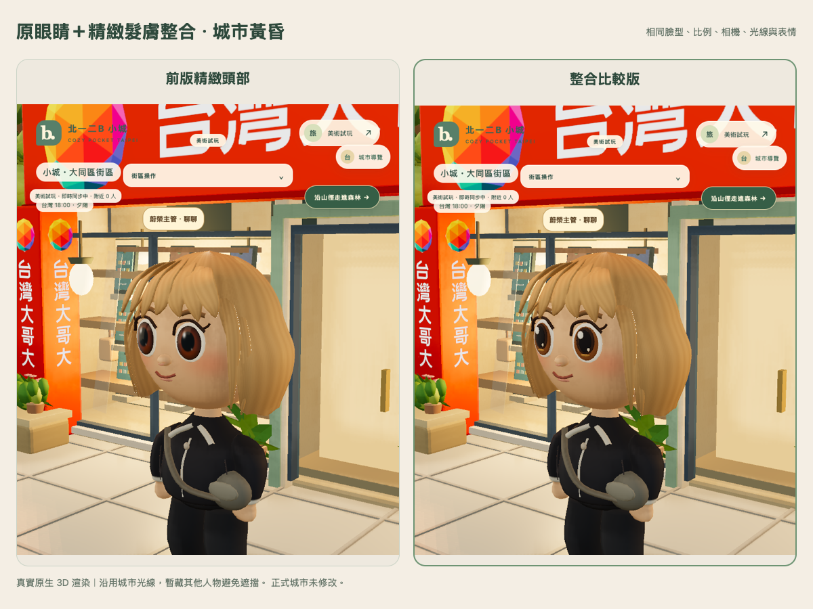

# 原版眼睛＋精緻髮型／皮膚：整合比較版

[開啟可旋轉獨立預覽](https://wings-screening-agenda-ghz.trycloudflare.com/)。可切換「前版精緻頭部／整合比較版」，拖曳環繞 360°。免費臨時入口仍於台北 **2026-10-31 23:59** 關閉。

本輪依確認方向整合，未修改正式城市或原角色資料。

## 本輪選擇

- **眼睛採原版**：從 `avatar-deluxe-approved.js` 完整還原原始眼白、虹膜、瞳孔與高光七層結構，包含幾何、比例、位置及材質，不使用前版 UV 虹膜／亮膜眼睛。眼瞼、睫毛與五官位置保留。
- **皮膚採精緻版**：皮膚幾何、腮紅、膚色／法線／粗糙度貼圖及材質參數保持前版；不是重新調整臉型。
- **髮型採精緻版**：保留連續髮面、立體瀏海與髮絲貼圖，小幅整理側髮根部、交疊路徑及收尾曲線；側髮尾端較圓潤。
- **頭髮反光更柔和**：roughness 0.65→0.76、specular intensity 0.45→0.28、anisotropy 0.22→0.12，法線擾動也稍降，減少亮面塑膠感。
- 2.5 頭身、臉型、頭部位置／尺寸、身高、腿長、身體、肩頸及動畫全部保留。

## 同條件比較

**左：前版精緻頭部（含前版新眼睛）；右：本次整合版（原版眼睛＋精緻髮膚）**。兩版使用相同 profile、相機、燈光與固定表情，皆為實際原生 3D 渲染。

[側面比較](comparison-studio-side.png)。

## 城市實景

沿用原城市光線。截圖只鎖定頁面呈現時間並暫藏其他人物以免遮擋，沒有更改伺服器時間、人物資料或正式環境。

[城市夜間](comparison-city-night.png)。實際日／昏／夜的 nightFactor 分別為 0／0.38／1。公開預覽中的正常城市仍使用即時時間與原人物。

## 驗證與負擔

- **模型 6/6 通過**：原版七層眼睛 source／geometry／material／pivot 完整恢復；精緻皮膚、身體、腿、肩頸與動畫保留；2.5 頭身和頭部外框保持；20 輪換裝／切換資源數穩定，普通 peer 沿用原 factory，dispose 不誤釋放共用貼圖。
- Chromium／Mac WebKit 的行走、保存位置、換髮型後續玩、雙人 WebSocket 同步及可見性、沙發坐下／離開回歸通過；沒有頁面錯誤、缺漏資產或 WebGL context loss。
- 本輪兩個版本的 helper 與 factory 分開凍結，因此前版不會跟著新髮型或材質一起改變。原眼睛基準是定版來源，前版精緻頭部則凍結於 `62435e995de18438145d984519fe1f1587d06099`。
- 公開 WebKit 預覽、城市即時同步連線、版本切換、頭部近看、返回工作室與單一 iframe 通過。已購海藍服裝在切換與 reload 後保留，錢包／profile 不因切換／reload 改變。
- 68 項公開資產 HTTP／SHA-256 相同，6 條私有路徑皆 404。

| 相同示範造型 | 前版精緻頭部 | 整合比較版 |
| --- | ---: | ---: |
| 全角色三角面 | 18,004 | 19,332 |
| 幾何陣列 bytes | 496,032 | 562,376 |
| 模型 geometry／material 數 | 17／10 | 13／9 |
| 工作室 draw calls | 19 | 15 |
| 實際使用頭部貼圖 | 7 | 6 |
| 單獨 context texture 計數（含陰影） | 8 | 7 |

還原多層眼睛會增加部分幾何，但減少眼睛亮膜材質及繪製次數。六張 skin/hair 貼圖與前版共用相同 Texture 物件，不會因前後切換重複建立；舊版另保留一張虹膜圖只供比較。整合版實際使用的貼圖加 mipmap 預算約 **4.0 MiB**，不是 Safari 程序或整個 GPU 的實測記憶體。

Mac WebKit 390×844、DPR 1、行動 30 fps 節流，分開 context 暖機後：兩版 p50 均約 **33 ms**，p95 均約 **35 ms**。不據此宣稱 GPU 成本完全相同或 iPhone Safari 已驗收；實體 iPhone 仍按使用者安排延後回去驗證。

[模型 raw log](model-tests.txt)、[原生比較與來源 SHA](native-capture.json)、[城市狀態](city-comparison.json)、[暖機效能](performance-webkit.json)、[雙引擎回歸](integration-browser.json)、[服裝續玩](wardrobe-browser.json)、[公開預覽](public-browser.json)、[公開資產](public-readback.json)、[保留檢查](preservation.json)。

前版預覽與模型／helper SHA 保持一致；正式城市 index SHA 仍是 `7816d64e87b831531ffbfb4e176043e65ebaa589b662ac8741d04816740158f6`。正式資料庫未開啟、正式寫入／額外獎勵發放 0。仍是待確認的獨立美術示範，未全面套用角色。
