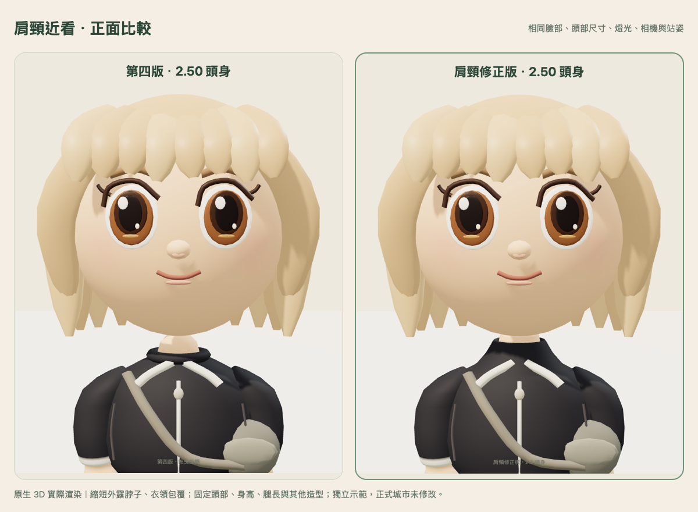
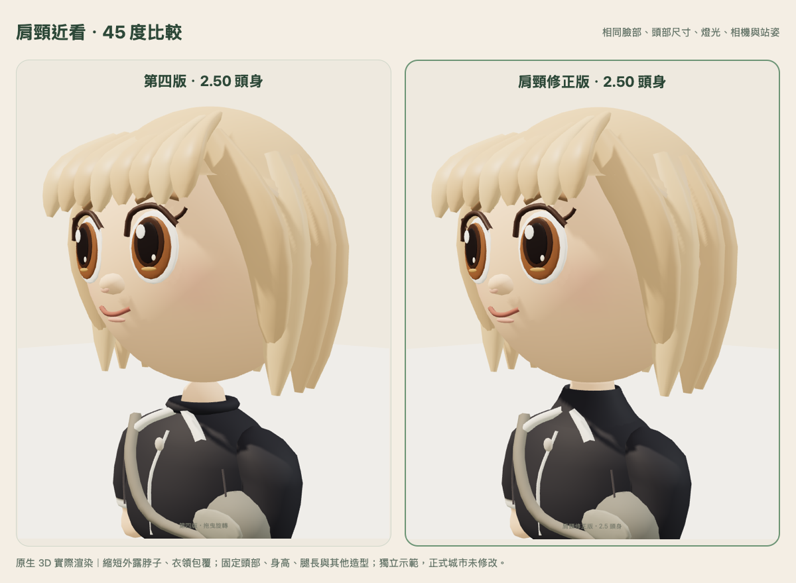
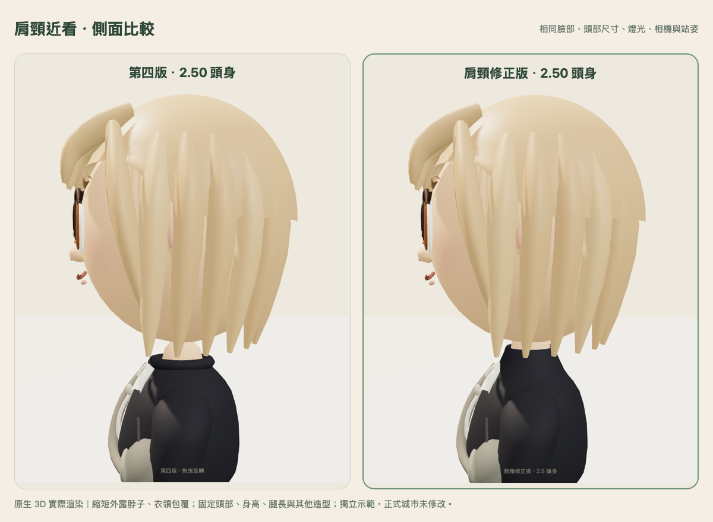

# 第四版肩頸局部修正版

[開啟獨立比較預覽](https://dietary-compare-rebel-timothy.trycloudflare.com/)。免費臨時入口依原期限於台北 **2026-10-31 23:59** 自動關閉。

本輪只替換第四版的頸部底座與衣領；第四版其餘造型保持原樣。修正版等待本人美術確認，未套用正式城市。

## 局部調整

- 將頸部改為寬底、逐漸收束的短底座，減少細圓柱的支撐感。
- 以有厚度、內外表面與真正領口開口的衣領包覆下段頸部，領口底部向肩膀展開。
- 頭部位置與尺寸不變，衣領提高後，站姿衣領頂部至下巴包圍盒的垂直間距由 0.06062 降至 0.01611 單位（約減少 73.4%）。這是特定站姿的幾何間距，不是實際照片的皮膚面積量測。
- 臉型、眼睛、髮型、2.5 頭身、身高、腿長、手臂、褲鞋、上衣其他部位及原動畫均保留。

## 比較圖

相同臉部、服裝、相機、燈光與站姿的原生 3D 實際渲染。**左第四版、右肩頸修正版**。

全身比較：[正面](comparison-front.png)、[45 度](comparison-quarter.png)、[側面](comparison-side.png)。城市近看：[修正版](game-close-new.png)、[第四版](game-close-old.png)。已購海藍服裝：[換裝續玩](wardrobe-ocean.png)。

## 保留與轉頭檢查

| 中立站姿量測 | 第四版 | 肩頸修正版 |
| --- | ---: | ---: |
| 頭身比 | 2.500 | 2.500 |
| 頭部高度 | 0.921200 | 0.921200 |
| 全身高度 | 2.303000 | 2.303000 |
| 單腿包圍盒高度 | 0.715000 | 0.715000 |
| 足底高度 | 0.010000 | 0.010000 |

- **5/5 模型測試通過**：第四版凍結檔與 commit `4b5e35131ce330d939f89497e236daef0a5ab202` 相同；buildHead／buildHair／buildLeg／animate 及手臂原始碼保留。頭部與四肢樞紐、比例、身高與腿長一致，肩頸幾何確有變化。版本切換保持 profile 契約，一般 peer 沿用原模型。20 次換裝循環資源數穩定。
- **1/1 肩頸幾何檢查通過**：四種既有髮型／服裝組合共 744 組姿勢，包含站立、走路、揮手、坐下、招呼、擊掌、跌坐，以及額外左右轉頭 ±60°／點頭 ±0.12 rad 的壓力採樣。以包圍盒與實際頭部三角網格射線檢查衣領頂點、邊中點與三角面中心，沒有衣領穿入下巴。保守間距下界保持正值；頸部上端與頭部內部的隱藏接合為預期結構。
- 臉部與動畫沒有為避免穿模而縮小、移位或停用。這些是模型採樣檢查，不宣稱涵蓋任意未定義的極端頭部動作。

## 遊戲功能與預覽

- Chromium／Mac WebKit，390×844 手機尺寸：行走、位置保存、購買既有髮型並重新載入、版本切換不改錢包與外觀、WebSocket 雙人同步及可見性、沙發坐下／離開通過；沒有頁面錯誤、缺漏資產或 WebGL context loss。
- Mac WebKit 補充服裝檢查：購買及保存既有海藍服裝，實際渲染、切換版本及重新載入後仍保留；切換／reload 沒有額外改變錢包或 profile。只使用獨立 SQLite 合成角色。
- 公開預覽通過工作室、城市即時同步、近看、版本切換、返回工作室及單一 iframe；66 項公開資產 HTTP／SHA-256 讀回一致，6 條私有路徑皆 404。

| 同一示範造型 | 第四版 | 肩頸修正版 |
| --- | ---: | ---: |
| 模型三角面 | 16,578 | 16,754（+1.06%） |
| 幾何陣列 bytes | 543,284 | 548,036（+0.87%） |
| 模型 geometry／material | 14／10 | 14／10 |
| 工作室 draw calls／texture | 16／1 | 16／1 |

本輪不增加貼圖、每幀建模、材質數或工作室繪製次數。Mac 的短時間渲染樣本保存在原始 JSON，未作為實體 iPhone 流暢度或記憶體驗收依據。

## 證據與邊界

[模型測試](model-tests.txt)、[頭頸間距](neck-clearance.json)、[間距測試](neck-clearance-tests.txt)、[原生比較與來源 SHA](native-capture.json)、[雙引擎功能](integration-browser.json)、[服裝續玩](wardrobe-browser.json)、[公開預覽](public-browser.json)、[公開資產](public-readback.json)、[保留檢查](preservation.json)。

原第四版公開入口／模型 SHA 仍一致；正式城市 index SHA 仍是 `7816d64e87b831531ffbfb4e176043e65ebaa589b662ac8741d04816740158f6`。未打開正式資料庫、正式寫入 0、獎勵發放 0，未修改原存檔或正式城市入口。

實體 iPhone Safari 的流暢度、長走、記憶體及背景返回尚未驗收；本輪交付的是獨立肩頸美術比較。
