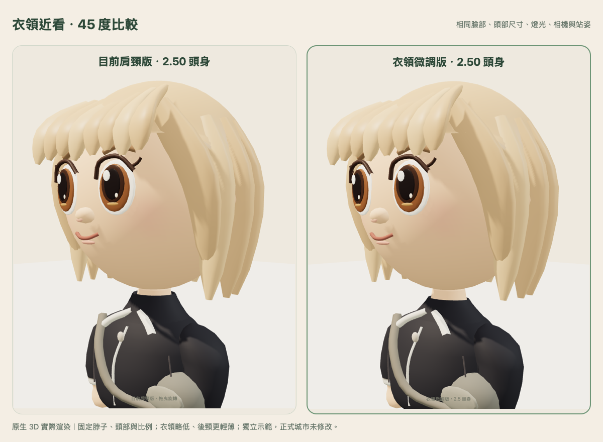
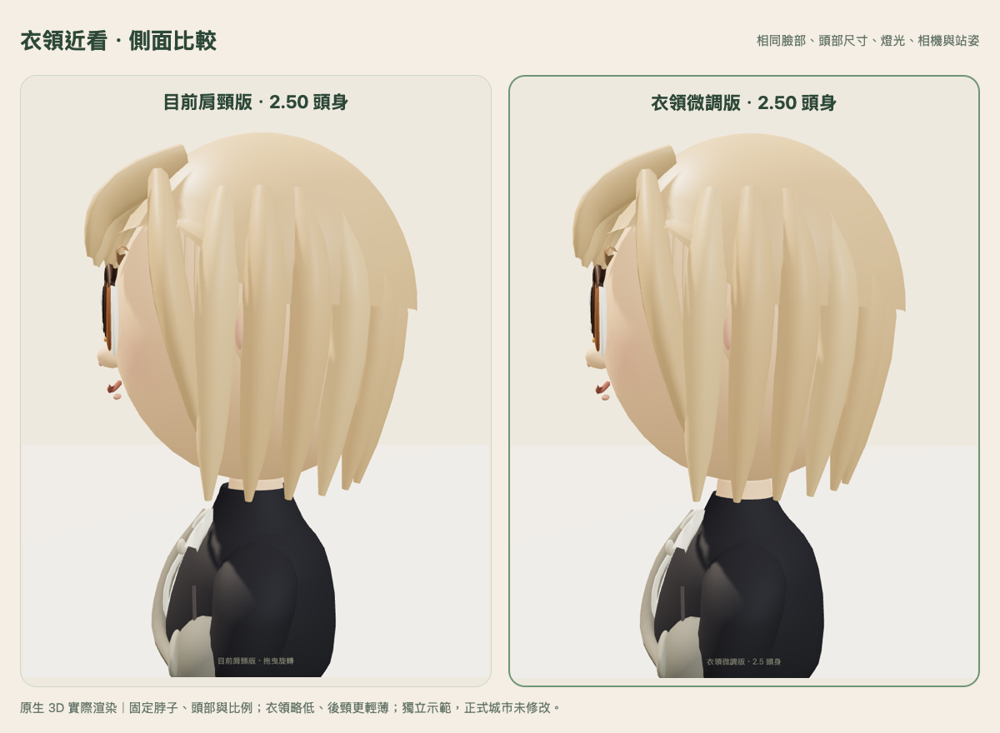

# 衣領最後微調：保留已認可的肩頸結構

[開啟獨立比較預覽](https://butler-rotation-maui-quarters.trycloudflare.com/)。免費臨時入口依原期限於台北 **2026-10-31 23:59** 自動關閉。

本輪只修改衣領外表面與內表面的輪廓數值。已認可的脖子本體、頭部位置／尺寸、臉型、眼睛、髮型、2.5 頭身、全身高度、腿長及其他造型保持原樣。微調版等待本人確認，未切換正式城市或原肩頸版入口。

## 微調內容

- 領口略低，後頸比前側再多收低一些，減少高領與後頸厚重感。
- 領緣較薄，衣領底部向肩膀平順展開。
- 頸部 mesh 與頭部完全不動；降低衣領後，下巴與領口間保留較自然的空間。
- 相對同一衣領底部，前側高度約降低 16%、後側約降低 21%。中立站姿衣領最高點由 1.30729 降到 1.28786；下巴最低點維持 1.32340，垂直間距從 0.01611 增至 0.03554 模型單位。這是幾何間距，不是實體公分。

## 45 度與側面比較

同一臉部、服裝、站姿、燈光與相機的原生 3D 實際渲染。**左目前肩頸版、右衣領微調版**。

全身比較：[45 度](comparison-quarter.png)、[側面](comparison-side.png)。城市近看：[微調版](game-close-new.png)、[目前肩頸版](game-close-old.png)。

## 保留範圍與轉頭檢查

| 項目 | 目前肩頸版 | 衣領微調版 |
| --- | ---: | ---: |
| 頭身比 | 2.500 | 2.500 |
| 頭部高度 | 0.921200 | 0.921200 |
| 全身高度 | 2.303000 | 2.303000 |
| 單腿包圍盒高度 | 0.715000 | 0.715000 |
| 足底高度 | 0.010000 | 0.010000 |

- **5/5 模型測試通過**：凍結版本 SHA 與 commit `822f8c33685c3e4af47213bfdf0ad6fdfbb3866c` 一致。嚴格比對只有兩個衣領 loft 的數值改變；頸部底座、頭部、髮型、動畫、腿部、手臂及其他身體造型來源完全相同。樞紐、尺寸、位置與比例保留。
- **1/1 轉頭間距測試通過**：四種既有髮型／服裝組合共 744 組姿勢，涵蓋站立、走路、揮手、坐下、招呼、擊掌、跌坐與額外左右轉頭 ±60°／點頭 ±0.12 rad。以包圍盒及實際頭部三角網格，檢查衣領頂點、邊中點與面中心，未發現衣領穿入下巴；不是宣稱涵蓋任意未定義極端動作。
- 20 次換裝循環的資源數穩定；新舊版本切換保留 profile 契約，一般 peer 保持原模型。

## 本輪瀏覽器與負擔

Mac WebKit 公開預覽通過工作室、城市即時同步連線、角色近看、兩版切換、返回工作室與單一 iframe；沒有頁面錯誤或缺漏資產。另以隔離合成角色購買並保存既有海藍服裝，確認實際渲染、版本切換及重新載入後保留，錢包與 profile 不因切換／reload 改變。

66 項公開資產 HTTP／SHA-256 讀回一致，6 條私有路徑均 404。兩版相同示範造型皆為 16,754 三角面、548,036 bytes 幾何陣列、14 份模型 geometry、10 份 material，工作室皆 16 次 draw calls、1 張 texture。本輪沒有增加上述渲染負擔。

本輪聚焦衣領，未重跑完整雙引擎步行／雙人同步回歸；移動、存檔與同步程式未修改，前輪紀錄保存在 `evidence/neck-v1/integration-browser.json`。實體 iPhone 的流暢度、長走、記憶體與背景返回仍未驗收。

## 證據與隔離

[模型測試](model-tests.txt)、[間距採樣](neck-clearance.json)、[間距測試](collar-clearance-tests.txt)、[原生比較與來源 SHA](native-capture.json)、[公開瀏覽器](public-browser.json)、[服裝續玩](wardrobe-browser.json)、[公開資產](public-readback.json)、[保留檢查](preservation.json)。

原肩頸版的公開入口與模型 SHA 保持一致；正式城市 index SHA 仍為 `7816d64e87b831531ffbfb4e176043e65ebaa589b662ac8741d04816740158f6`。沒有開啟正式資料庫、正式資料寫入或獎勵發放，原存檔與正式入口未修改。
